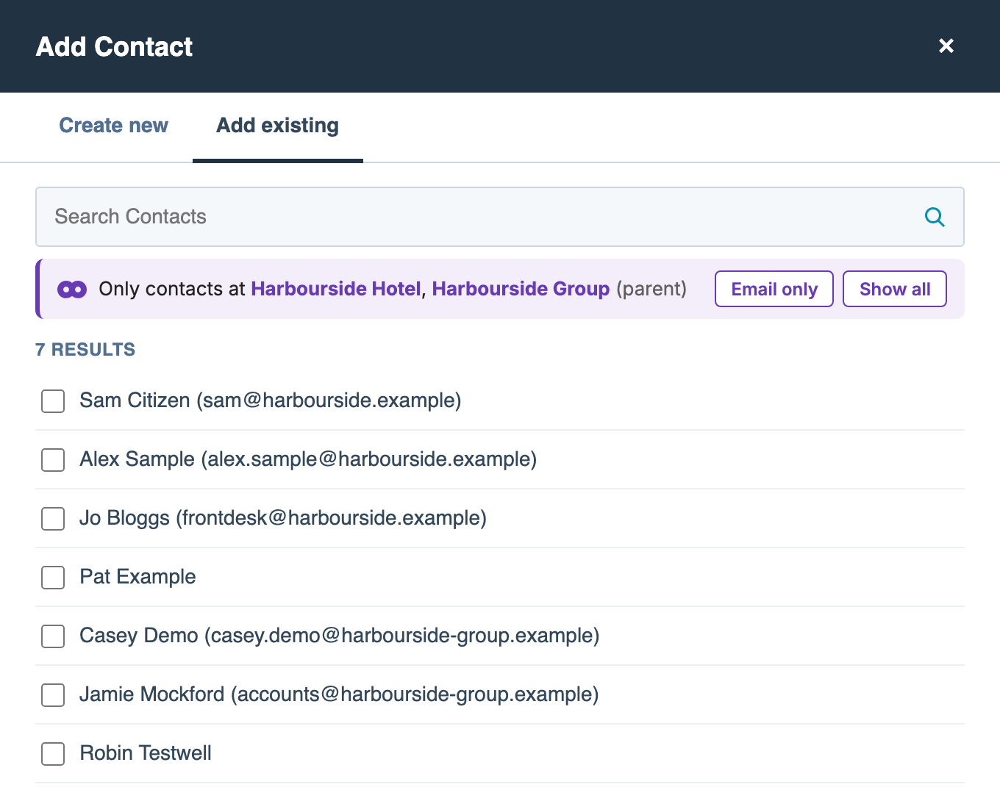
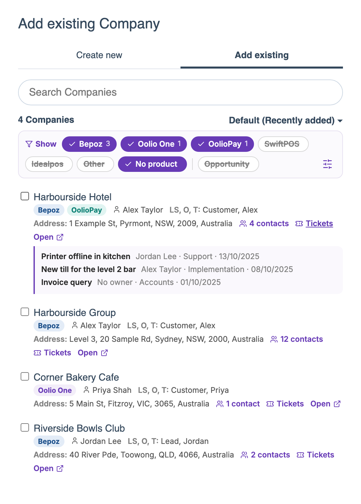
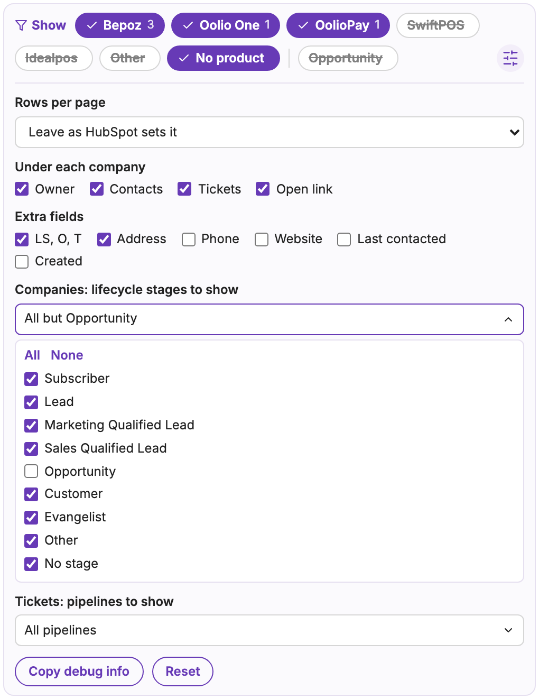

# HubSpot: Company filters

[Install](https://raw.githubusercontent.com/StephenShawBepoz/browserscripts/main/hubspot/company-contacts.user.js) · [All scripts](../README.md) · [What changed](../CHANGELOG.md)

This used to be two scripts, *Company contacts* and *Products in company search*. If you had *Company contacts*, it updates to this one by itself. If you had *Products in company search*, delete it: click the Tampermonkey icon, then **Dashboard**. While both are installed only one of them works in *Add existing Company*, so you may not see the **Opportunity** chip.

## Add existing Contact

Made-up example. The HubSpot page around the script is a mock-up, so the real one looks a little different.

1. On a ticket or deal, click **Add** on the Contacts card and open the **Add existing** tab.
2. The list only shows contacts at the record's companies and their parent companies (often the group's head office), 100 to a page. The purple bar under the search box names the companies it used.
3. **Can't find someone?** Click **Show all** to search every contact before you create a new one. The next ticket or deal starts with company contacts again.

**Email only** hides contacts without an email address. It stays on until you turn it off.

To see 10 or 20 to a page, pick it from HubSpot's own page-size menu. It stays that way for the rest of that panel.

**If the bar turns amber,** it says what's wrong:
- *Couldn't load the companies*: all contacts are listed. Click **Try again**.
- *HubSpot didn't refresh the list*: the list may not match the bar. Type in the search box.
- *The company filter isn't working*: HubSpot has changed, so all contacts are listed. Let Stephen know. The browser console (search for *Oolio company contacts*) shows more.

**Had *Company contacts* before it was on GitHub?** Install it from the **Install** link at the top, then delete the old copy, called *HubSpot: company contacts in "Add existing Contact"* (version 1.2.0 or earlier): click the Tampermonkey icon, then **Dashboard**. Until you do, the bar reminds you.

## Add existing Company

Made-up example. The HubSpot page around the script is a mock-up, so the real one looks a little different.

1. On a contact or ticket, go to the Companies card, click **Add** and pick **Add existing**.
2. Each company shows its products, owner and contacts underneath, plus **Tickets** and **Open** (opens the company in a new tab). Click the contacts or **Tickets** link to list them right there. Each ticket shows its owner, pipeline and created date.
3. The chips above the list choose which companies you see, and HubSpot only searches those, so the count and pages only include your companies. Click a chip to switch it on or off, and the script remembers your choice.
   - **Products:** Idealpos, SwiftPOS and Other start switched off.
   - **Opportunity:** companies whose lifecycle stage is *Opportunity* start hidden. Click the chip to show them.
   - **Other lifecycle stages:** pick them in settings under **Companies: lifecycle stages to show**. The bar says how many are hidden.
4. **Show** brings hidden companies back, faded. If a whole page is hidden, click **Next page** in the bar.
5. Click the sliders icon to change rows per page, what shows under each company, which lifecycle stages to show, or to add extra fields such as address or phone. **Reset** puts every setting back to how it started.
6. **Tickets: pipelines to show** in settings leaves the pipelines you untick out of each company's **Tickets** list. Type in **Find** to narrow the list; **All** and **None** apply to the pipelines it shows.

If something looks wrong, open the settings, click **Copy debug info** and send it to Stephen.

---

Something not right? Message Stephen Shaw on Teams.
