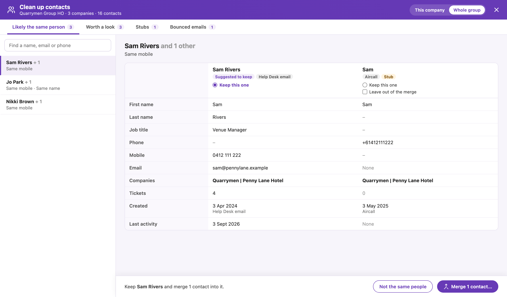

# HubSpot: Contact clean-up

[Install](https://raw.githubusercontent.com/StephenShawBepoz/browserscripts/main/hubspot/contact-cleanup.user.js) · [All scripts](../README.md) · [What changed](../CHANGELOG.md)

Made-up example. The HubSpot page around the script is a mock-up, so the real one looks a little different.

1. Open a company record and click **Clean up contacts** under the phone number.
2. On a head office it looks at the head office and every venue under it. On a venue, switch between **This company** and **Whole group** at the top.
3. Pick a group on the left. Its contacts are side by side, with the one to keep suggested.
4. Check them, choose **Keep this one**, and where a field differs (say, two first names), click the value you want. **Leave out of the merge** takes someone out of the group.
5. Click **Merge**, check the summary, and confirm. Or click **Not the same people** and they won't be grouped again.

**A merge can't be undone.** Everything on the merged contact (emails, calls, notes, tickets, companies) moves to the one you keep, and their email becomes an extra email on it.

### The four lists

- **Likely the same person:** the same mobile number and names that fit (*Chris* and *Christopher*, or a first name on one and the full name on the other), or the same full name where one of them has no email.
- **Worth a look:** weaker matches. The same landline (it could be the venue's number), the same full name where each has their own email, a first-name-only contact at the same venue as someone with that name, or a group whose first names don't all fit (*Christine* and *Christopher*). Check these carefully.
- **Stubs:** contacts with no email, no last name and no tickets that don't match anyone. Aircall calls and the February 2025 import made most of them. Open one to fill it in or merge it by hand. Nothing is deleted.
- **Bounced emails:** contacts whose email has bounced, who may have left the venue.

### Good to know

- It never treats a shared phone on its own as a match. A venue's duty mobile or landline is often on several people.
- The suggested contact to keep is the one with a working email, then the most tickets and history. A venue mailbox such as *enquiries@* gets a **Shared mailbox** tag, and a person's own email is preferred over it.
- Values you pick are copied onto the kept contact before the merge and again after it, so they stick.
- Nothing changes in HubSpot until you confirm a merge. Opening the screen only reads.
- To forget every **Not the same people**, click the Tampermonkey icon, then **Forget every "Not the same people"**.
- The browser console (search for *Oolio contact clean-up*) shows what it found and every merge it made.

---

Something not right? Message Stephen Shaw on Teams.
