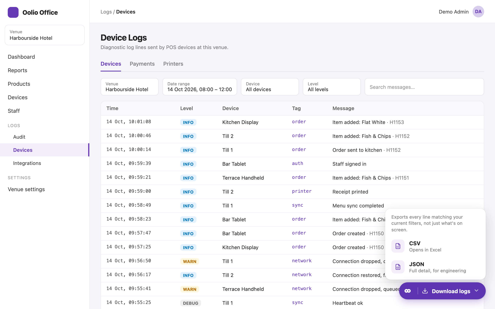

# Oolio Office: Download Device Logs

[Install](https://raw.githubusercontent.com/StephenShawBepoz/browserscripts/main/oolio-office/device-logs.user.js) · [All scripts](../README.md) · [What changed](../CHANGELOG.md)

 Devices, with the CSV and JSON choice open">
Made-up example. The Oolio Office page around the script is a mock-up, so the real one looks a little different.

1. In Oolio Office, go to **Logs > Devices** and set the venue, date range and filters.
2. Click **Download logs** (bottom right) and pick **CSV** (for Excel) or **JSON**.
3. The file saves to Downloads, named with the date range.

---

Something not right? Message Stephen Shaw on Teams.
