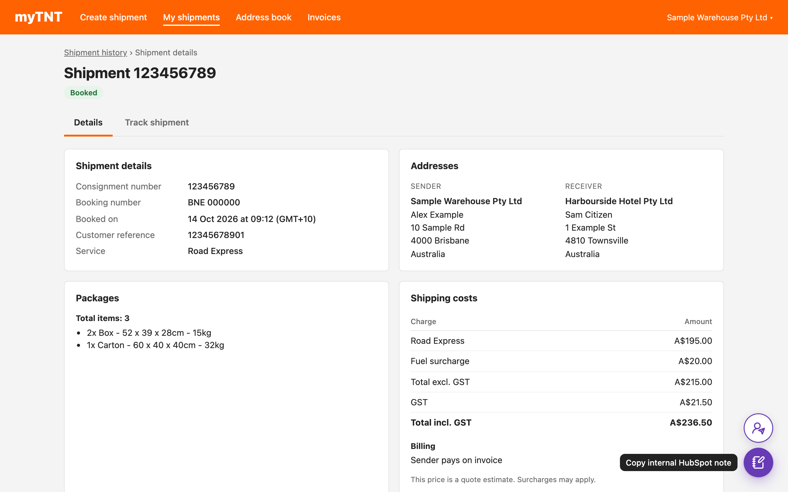

# myTNT: Copy HubSpot note

[Install](https://raw.githubusercontent.com/StephenShawBepoz/browserscripts/main/tnt/copy-hubspot-note.user.js) · [All scripts](../README.md) · [What changed](../CHANGELOG.md)


<sub>Made-up example. The myTNT page around the script is a mock-up, so the real one looks a little different.</sub>

1. In myTNT, go to **My shipments > Shipment history** and click the shipment.
2. Bottom right there are two round buttons. Hover over one to see what it does.
   - Purple, notebook: **Copy internal HubSpot note** for the ticket.
   - White, person with a paper plane: **Copy customer message** for your reply to the customer.

   The button turns into a green tick when it's copied.
3. Paste (**Cmd + V** on Mac, **Ctrl + V** on Windows): the note into a HubSpot ticket note, the customer message into your reply or email.

The HubSpot note looks like this (made-up example). The tracking and ticket addresses are links:

```
Item sent via TNT
Consignment: 123456789
Tracking: https://www.tnt.com/express/en_au/site/shipping-tools/tracking.html?searchType=con&cons=123456789
HubSpot ticket: https://app.hubspot.com/contacts/5205495/record/0-5/12345678901

Shipment
Sent: 14/10/2026
Service: Road Express
Pieces: 3, 62 kg
From: Oolio Queensland

Delivering to
Example Venue Pty Ltd
Sam Citizen
Townsville QLD 4810

For accounts
Booking number: BNE 000000
Excl. GST: A$215.00
GST: A$21.50
Total incl. GST: A$236.50
Billing: Sender pays on invoice
Invoiced to: Bepoz Global, TNT account 012345678
Note: TNT quote. Surcharges may be added on the invoice.
```

The customer message looks like this:

```
Hi Sam,

Thanks for your order. Your shipment is ready and has been booked with TNT/FedEx.

Consignment number: 123456789
Track your delivery: https://www.tnt.com/express/en_au/site/shipping-tools/tracking.html?searchType=con&cons=123456789
Expected delivery: Friday 16/10/2026
Items: 3

It can take a few hours after booking for tracking to show the first update.

If you have any questions, just reply to this email.
```

Good to know:

- **Sent** is the collection date and **Expected delivery** is TNT's delivery date. myTNT only shows these in the shipment list and on the **Track shipment** tab, so open the shipment from **Shipment history** (as in step 1). If you came in another way, Sent shows the booking date and the customer message leaves out the delivery date (the copied message tells you).
- The customer message greets the receiver's contact by first name, or says "Hi there" if there isn't one. Read it before sending.
- The state is worked out from the postcode. myTNT doesn't show it. Weight is the total for the whole shipment.
- If the customer reference is a HubSpot ticket number, the note adds a **HubSpot ticket** link. Other references, like order numbers, show as **Reference**. The customer message never includes the reference.
- **For accounts** shows TNT's quoted price from myTNT. If TNT lists more than one charge (for example a surcharge), each one is shown.
- Any line myTNT doesn't have is left out. If the consignment number or receiver is missing, nothing is copied and a red message says what's missing.
- On the **Track shipment** tab, switch to **Details** first.
- Straight after booking, the **Your booking is done** screen also has both buttons. The note is short (consignment and reference only), and the customer message has no name or delivery date, because that's all the screen shows. For the full versions, open the shipment from Shipment history.
- Keep myTNT in English. Dates in other languages aren't read.
- Nothing is sent anywhere. The note only goes to your clipboard. To fill in the dates, the script remembers collection and delivery dates from the shipment list in that browser tab until you close it.

---

Something not right? Message Stephen Shaw on Teams.
