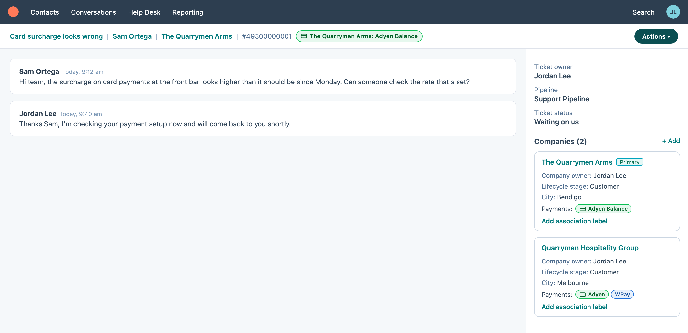

# HubSpot: Payments badge

[Install](https://raw.githubusercontent.com/StephenShawBepoz/browserscripts/main/hubspot/payments-badge.user.js) · [All scripts](../README.md) · [What changed](../CHANGELOG.md)

Made-up example. The HubSpot page around the script is a mock-up, so the real one looks a little different.

1. Open a company, a ticket, or a ticket in Help Desk.
2. A badge says what the venue pays through:
   - On a **company** or **ticket record**, it's under the name at the top left.
   - In **Help Desk**, it's next to the ticket title, with the company's name, for example **Maclean Fuel: WPay**.
   - Every **company card** in the sidebar gets a **Payments:** line too, so a ticket with two companies shows both.
3. Hover the badge to see where it came from and the merchant ID.

| Badge | Means (the company's *Acquirer - POS*) |
|---|---|
| Green **Adyen Balance** | Adyen Balance |
| Green **Adyen Manage** | Adyen Manage |
| Blue **WPay** | WPay |
| Green **Adyen** and blue **WPay** together | Adyen + WPay |

- When *Acquirer - POS* is blank but the company has an Adyen or WPay merchant ID, the badge goes by the merchant ID and has a **dashed** outline. Hovering it says so. It's worth filling in *Acquirer - POS* on that company.
- No badge means the company has neither *Acquirer - POS* nor a merchant ID, which is normal for a venue that doesn't use Oolio Pay.
- It only reads HubSpot. Nothing is ever changed.
- If someone changes the field while you have the page open, the badge updates when you next open the record, or straight away from the Tampermonkey menu with **Read payments again**.
- To turn it off, click the Tampermonkey icon, then **Turn payments badge off**.
- If it doesn't appear when you expect, the browser console (search for *Oolio payments badge*) says what it found.

---

Something not right? Message Stephen Shaw on Teams.
