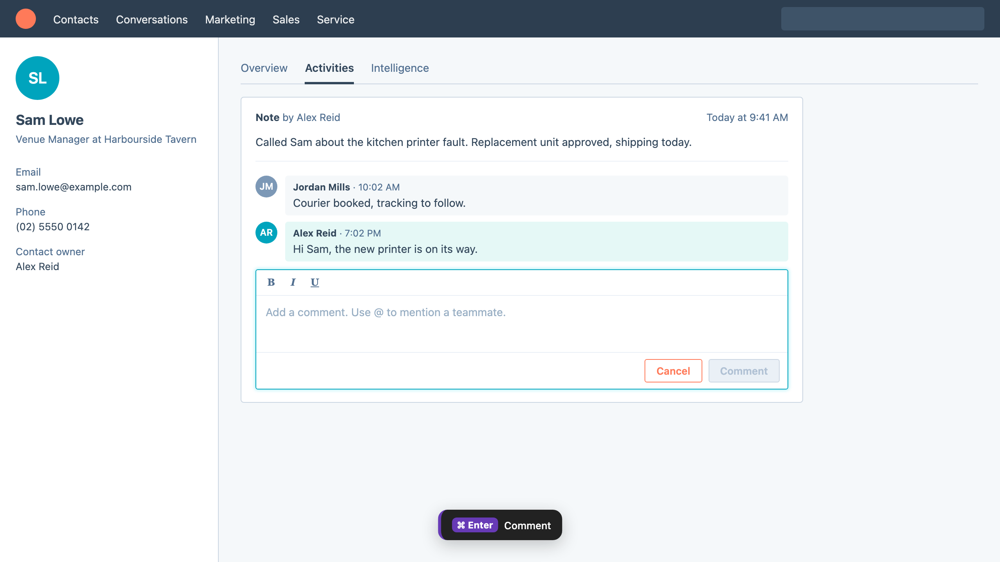

# HubSpot: Cmd/Ctrl + Enter to send

[Install](https://raw.githubusercontent.com/StephenShawBepoz/browserscripts/main/hubspot/send-shortcut.user.js) · [All scripts](../README.md) · [What changed](../CHANGELOG.md)

Made-up example. The HubSpot page around the script is a mock-up, so the real one looks a little different.

1. Type a comment, note or email reply in HubSpot.
2. Press **Cmd + Enter** (Mac) or **Ctrl + Enter** (Windows).
3. It presses that box's **Send**, **Comment**, **Save**, **Create** or **OK** button, and a small message shows which one. Where there's no such button, it stays out of the way and leaves the key to HubSpot.

It never presses Cancel, Delete or Schedule, and does nothing if it can't tell which button belongs to the box you're typing in.

---

Something not right? Message Stephen Shaw on Teams.
