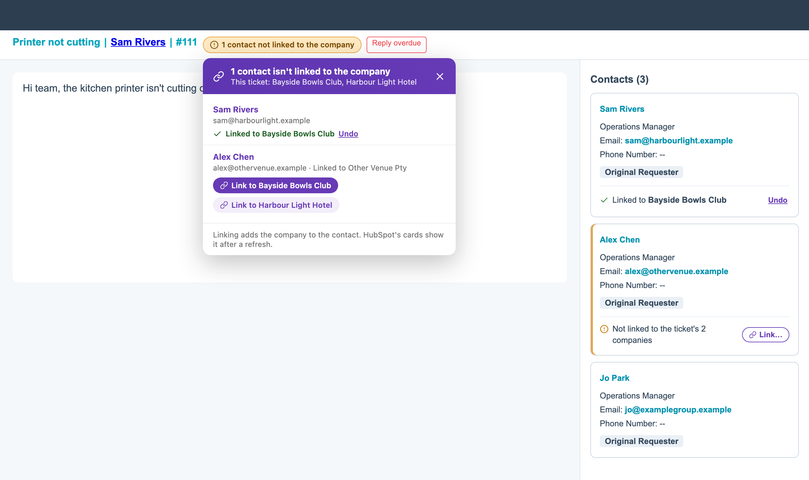

# HubSpot: Unlinked contacts

[Install](https://raw.githubusercontent.com/StephenShawBepoz/browserscripts/main/hubspot/unlinked-contacts.user.js) · [All scripts](../README.md) · [What changed](../CHANGELOG.md)

Made-up example. The HubSpot page around the script is a mock-up, so the real one looks a little different.

1. Open a ticket in Help Desk (or a ticket's record page).
2. If someone on the ticket isn't linked to the ticket's company, an amber chip appears next to the ticket title, for example **1 contact not linked to the company**. Their card in the *Contacts* card gets an amber edge and a line at the bottom saying so.
3. Click **Link** on the card, or click the chip and then **Link to** *company* in the list. The contact is linked to that company straight away.

- **Undo** shows for a few seconds after you link someone and takes the link off again.
- A contact counts as linked if they're on one of the ticket's companies **or its parent company**, so head office staff on a venue ticket aren't flagged.
- When the ticket has more than one company, the list has a **Link to** button for each, with the primary company first.
- A contact with no company at all gets the one you pick as their primary company, the same as HubSpot does when you add a first company. Anyone who already has companies keeps their primary company; the new one is added alongside it.
- The list says which company the contact is on now (for example *Linked to Other Venue Pty*), so you can spot someone who's moved or is on the wrong record.
- HubSpot's own cards don't redraw by themselves, so the company shows on the contact's card after you refresh.
- Nothing shows when everyone is linked, or when the ticket has no company.
- To turn it off, click the Tampermonkey icon, then **Turn unlinked contacts off**. **Check this ticket again** is there too.
- If it doesn't appear when you expect, the browser console (search for *Oolio unlinked contacts*) says what it found.

---

Something not right? Message Stephen Shaw on Teams.
